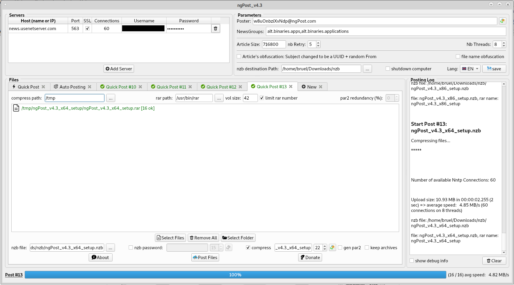

# ngPost-2026

[English](README.md) | [Français](README_FR.md) | **Deutsch** | [Italiano](README_IT.md) | [Español](README_ES.md)

**ngPost-2026** ist eine überarbeitete und neu gestaltete Version des bekannten Usenet-Uploaders **ngPost**. 
Es ist ein Fork von [mbruel/ngPost](https://github.com/mbruel/ngPost) (v4.16, Lizenz GPL v3). Das Verdienst für das ursprüngliche Programm gebührt seinem Autor, Matthieu Bruel. 

### Was in diesem Fork anders ist
-   **Sicherheitskorrektur**: möglicher Heap-Überlauf im yEnc-Kodierungspuffer (die Ausgabe konnte bei bestimmten Daten größer als der Puffer sein)
-   **Sicherere Passwörter**: die erzeugten Archiv-Passwörter und -Namen verwenden den kryptografischen Zufallsgenerator des Betriebssystems (Qt >= 5.10) statt `std::rand()`
-   **NZB_POST_CMD**: die Platzhalter dürfen Leerzeichen enthalten (ein Pfad wie `C:\Meine Ordner\datei.nzb` bleibt EIN Argument) und der Befehl wird im Hintergrund gestartet (ngPost wartet nicht mehr darauf, daher wird sein Exit-Code nicht mehr protokolliert)
-   **RAR_EXTRA und PAR2_ARGS**: werden unter Beachtung der Anführungszeichen ausgewertet. 7-Zip wird am Programmnamen erkannt und nicht am gesamten Pfad
-   **ParPar** (ein viel schnellerer par2-Generator) wird für Windows 64bit mitgeliefert (v0.4.6, gemeinfrei) und automatisch verwendet, wenn sich `parpar.exe` im ngPost-Ordner befindet. Das 64bit-par2cmdline wurde aus dem Paket entfernt, das 32bit-Programm bleibt für Windows 32bit erhalten

Dieser Fork veröffentlicht noch keine Binärdateien: Kompiliere ihn aus dem Quellcode (siehe unten). Die Download-Links der Installationsabschnitte gehören zum originalen ngPost v4.16 und enthalten die obigen Änderungen nicht. 
 

**Usenet-Poster für die Kommandozeile und mit schicker GUI** für Binärdateien, entwickelt in **C++11/Qt5** 
er ist darauf ausgelegt, **so schnell wie möglich** zu sein und ALLE wichtigen Funktionen zu bieten, **um Daten einfach und sicher zu posten**. 
er kann **komprimieren** (mit deinem externen rar-Programm) und vor dem Posten **die par2-Dateien erzeugen**! 
er hat eine **Warteschlange**, um mehrere Posts vorzubereiten (besonders in der GUI mit Tabs). 
er **packt den nächsten Post, während der aktuelle hochgeladen wird** (Komprimierung + par2-Erzeugung) 
er kann Posts **automatisieren**, indem er **Ordner scannt** und jede Datei/jeden Ordner einzeln postet, nachdem sie komprimiert (mit eventuell zufälligem Archivnamen und Passwort) und die par2 erzeugt wurden! 
er kann **Ordner überwachen und jede neue Datei/jeden neuen Ordner** einzeln posten, nachdem sie komprimiert wurden. 
er kann **Dateien/Ordner nach dem Posten automatisch löschen** (nur beim Überwachen in der GUI und mit --auto und --monitor in der Kommandozeile) 
er kann nach jedem Post **einen BEFEHL oder ein Skript ausführen** (siehe NZB_POST_CMD in der Konfigurationsdatei) 
er kann **den Computer ausschalten**, wenn alle Posts fertig sind 
er ist **übersetzt in Chinesisch, Niederländisch, Englisch, Französisch, Deutsch, Portugiesisch und Spanisch**. 

[Releases des originalen ngPost sind verfügbar](https://github.com/mbruel/ngPost/releases/tag/v4.16) für: Linux 64bit, Windows (32bit und 64bit), MacOS und Raspbian (RPI 4). Bald auch für Android und dann iOS...

Hier sind die wichtigsten Funktionen und Vorteile von ngPost:

-   **vollständige Verschleierung des Artikel-Headers**: der Betreff ist eine UUID (wie die msg-id) und es wird ein zufälliger Absender verwendet. **Achtung**: dann findest du deinen Post auf Usenet (oder in Indexern) nicht mehr, wenn du die NZB-Datei verlierst. Diese Methode ist aber **völlig sicher**, **du musst weder deine Dateien verschleiern noch ein Passwort verwenden**.
-   **Warteschlange**: du kannst mehrere Posts vorbereiten, während du etwas postest. Ausstehende Posts kannst du natürlich abbrechen ;)
-   **Post-Automatisierung**: einen Ordner scannen und jede Datei/jeden Ordner nach der Komprimierung posten. (siehe **--auto in der Kommandozeile** und den Tab "Auto Posting" in der GUI)
-   **Komprimierung mit RAR oder 7zip** (externer Befehl) mit zufälliger **Namensverschleierung** und Passwort sowie **par2-Erzeugung** vor dem Posten
-   **Verlauf der Posts in einer csv-Datei**: so erhältst du Datum, **Dateiname**, Größe, Upload-Geschwindigkeit und vor allem **Archivname und Passwort** in einer einfachen Excel-Tabelle ;)
-   **ParPar** (viel schneller als par2cmdline) wird unter Windows 64bit automatisch verwendet, wenn sich `parpar.exe` im ngPost-Ordner befindet (die Windows-64bit-Version liegt in `release/libs`). **par2cmdline** ist weiterhin für Windows 32bit enthalten, und du kannst mit den Schlüsselwörtern PAR2_CMD und PAR2_ARGS in der Konfigurationsdatei auch ein anderes Programm (wie Multipar) verwenden
-   unterstützt **mehrere Dateien** und **mehrere Ordner**
-   unterstützt **mehrere Server** (über die Konfigurationsdatei oder die GUI), jeweils mit **mehreren Verbindungen** (mit SSL)
-   verteilt diese Verbindungen auf **mehrere Threads**. Standardmäßig die Anzahl der Kerne des Rechners, du kannst die Zahl aber festlegen.
-   **bereitet die Artikel im Haupt-Thread vor** (yEnc-Kodierung), sodass die Upload-Threads **immer schreibbereit** sind. (jede Verbindung hat 2 Artikel im Voraus bereit)
-   verwendet **asynchrone Sockets** in den Upload-Threads
-   **minimiert die Festplattenzugriffe**: die zu postenden Dateien werden nur einmal im Haupt-Thread geöffnet und nacheinander verarbeitet (es müssen nicht mehrere Dateien gleichzeitig geöffnet sein, die Artikel werden auf alle Verbindungen verteilt)
-   erzeugt einen **zufälligen Absender** (from), kann aber auch einen festen verwenden
-   **erzeugt die NZB-Datei**
-   **behandelt Unterbrechungen**: wird ein Post gestoppt, **wird die NZB mit den bereits geposteten Dateien erzeugt** und sie **listet die nicht geposteten Dateien auf**, sodass du nur diese erneut posten und die NZB-Dateien dann von Hand zusammenfügen kannst. (in der Kommandozeile würde sich die Anwendung ordnungsgemäß beenden)
-   **Meta-Daten im Header der NZB hinzufügen** (typischerweise ein Passwort)
-   Artikel bei einem Fehler **mit einer anderen UUID** erneut posten
-   bei einem Socket-Fehler erneut verbinden (gleicher Retry-Parameter wie bei den Artikeln)
-   ...

### Kompilieren
#### Abhängigkeiten:
- build-essential (C++-Compiler, libstdc++, make, ...)
- qt5-default (Qt5-Bibliotheken und Header)
- qt5-qmake (um die moc-Dateien und das Makefile zu erzeugen)
- libssl (v1.0.2 oder v1.1), sollte aber bereits auf deinem System installiert sein

#### Build:
- in den Ordner src wechseln
- qmake
- make

Einfach! Es sollte die ausführbare Datei **ngPost** erzeugt haben 
du kannst sie in einen Ordner deines PATH kopieren, dann ist sie überall verfügbar

Da es in C++/Qt geschrieben ist, kannst du es auf jedem Betriebssystem (Linux / Windows / MacOS / Android) kompilieren und ausführen.  
Releases gab es bisher nur für Linux x64, Windows x64 (ab Windows 7) und MacOS 
Um auf einem anderen Betriebssystem zu kompilieren, ist es am einfachsten, [Qt zu installieren](https://www.qt.io/download) und das Projekt in QtCreator zu laden 

### Verwendung in der Kommandozeile (die Optionsbeschreibungen sind die englische Ausgabe des Programms)
<pre>
Syntax: ngPost (options)* (-i <file or folder> | --auto <folder> | --monitor <folder>)+
	--help             : Help: display syntax
	-v or --version    : app version
	-c or --conf       : use configuration file (if not provided, we try to load $HOME/.ngPost)
	--disp_progress    : display cmd progressbar: NONE (default), BAR or FILES
	-d or --debug      : display extra information
	--fulldebug        : display full debug information
	-l or --lang       : application language
	--check            : check nzb file (if articles are available on Usenet) cf https://github.com/mbruel/nzbCheck
	-q or --quiet      : quiet mode (no output on stdout)

// automated posting (scanning and/or monitoring)
	--auto             : parse directory and post every file/folder separately. You must use --compress, should add --gen_par2, --gen_name and --gen_pass
	--monitor          : monitor directory and post every new file/folder. You must use --compress, should add --gen_par2, --gen_name and --gen_pass
	--rm_posted        : delete file/folder once posted. You must use --auto or --monitor with this option.

// quick posting (several files/folders)
	-i or --input      : input file to upload (single file or directory), you can use it multiple times
	-o or --output     : output file path (nzb)
	-x or --obfuscate  : obfuscate the subjects of the articles (CAREFUL you won't find your post if you lose the nzb file)
	-g or --groups     : newsgroups where to post the files (coma separated without space)
	-m or --meta       : extra meta data in header (typically "password=qwerty42")
	-f or --from       : poster email (random one if not provided)
	-a or --article_size: article size (default one: 716800)
	-z or --msg_id     : msg id signature, after the @ (default one: ngPost)
	-r or --retry      : number of time we retry to an Article that failed (default: 5)
	-t or --thread     : number of Threads (the connections will be distributed amongs them)
	--gen_from         : generate a new random email for each Post (--auto or --monitor)

// for compression and par2 support
	--tmp_dir          : temporary folder where the compressed files and par2 will be stored
	--rar_path         : RAR absolute file path (external application)
	--rar_size         : size in MB of the RAR volumes (0 by default meaning NO split)
	--rar_max          : maximum number of archive volumes
	--par2_pct         : par2 redundancy percentage (0 by default meaning NO par2 generation)
	--par2_path        : par2 absolute file path (in case of self compilation of ngPost)
	--auto_compress    : compress inputs with random name and password and generate par2 (equivalent of --compress --gen_name --gen_pass --gen_par2)
	--compress         : compress inputs using RAR or 7z
	--gen_par2         : generate par2 (to be used with --compress)
	--rar_name         : provide the RAR file name (to be used with --compress)
	--rar_pass         : provide the RAR password (to be used with --compress)
	--gen_name         : generate random RAR name (to be used with --compress)
	--gen_pass         : generate random RAR password (to be used with --compress)
	--length_name      : length of the random RAR name (to be used with --gen_name), default: 17
	--length_pass      : length of the random RAR password (to be used with --gen_pass), default: 13
	--rar_no_root_folder: Remove root (parent) folder when compressing Folders using RAR

// you can provide servers in one string using -S and/or split the parameters for ONE SINGLE server (this will overwrite the configuration file)
	-S or --server     : NNTP server following the format (&lt;user&gt;:&lt;pass&gt;@@@)?&lt;host&gt;:&lt;port&gt;:&lt;nbCons&gt;:(no)?ssl
	-h or --host       : NNTP server hostname (or IP)
	-P or --port       : NNTP server port
	-s or --ssl        : use SSL
	-u or --user       : NNTP server username
	-p or --pass       : NNTP server password
	-n or --connection : number of NNTP connections

Examples:
  - with monitoring: ngPost_v4.16_cmd-x86_64.AppImage --monitor /data/folder1 --monitor /data/folder2 --auto_compress --rm_posted --disp_progress files
  - with auto post: ngPost_v4.16_cmd-x86_64.AppImage --auto /data/folder1 --auto /data/folder2 --compress --gen_par2 --gen_name --gen_pass --rar_size 42 --disp_progress files
  - with compression, filename obfuscation, random password and par2: ngPost_v4.16_cmd-x86_64.AppImage -i /tmp/file1 -i /tmp/folder1 -o /nzb/myPost.nzb --compress --gen_name --gen_pass --gen_par2
  - with config file: ngPost_v4.16_cmd-x86_64.AppImage -c ~/.ngPost -m "password=qwerty42" -f ngPost@nowhere.com -i /tmp/file1 -i /tmp/file2 -i /tmp/folderToPost1 -i /tmp/folderToPost2
  - with all params:  ngPost_v4.16_cmd-x86_64.AppImage -t 1 -m "password=qwerty42" -m "metaKey=someValue" -h news.newshosting.com -P 443 -s -u user -p pass -n 30 -f ngPost@nowhere.com  -g "alt.binaries.test,alt.binaries.test2" -a 64000 -i /tmp/folderToPost -o /tmp/folderToPost.nzb

If you don't provide the output file (nzb file), we will create it in the nzbPath with the name of the first file or folder given in the command line.
so in the second example above, the nzb would be: /tmp/file1.nzb
</pre>

### Konfigurationsdatei und Schlüsselwörter, die nur dort vorkommen
Die Standard-Konfigurationsdatei unter Linux und Mac ist: **~/.ngPost** (ohne Endung .conf) 
Wenn du möchtest, kannst du in der Kommandozeile mit der Option -c eine andere verwenden. 
[Hier das Beispiel](https://github.com/mbruel/ngPost/blob/master/ngPost.conf). 
 
Die meisten Schlüsselwörter der Konfiguration können auch in der Kommandozeile verwendet werden, einige gibt es aber nur in der Konfigurationsdatei:
- **MONITOR_NZB_FOLDERS**: jeder überwachte Post kommt in einen eigenen Ordner innerhalb von nzbPath (Req/Issue #15)
- **inputDir**: Standardordner zum Auswählen von Dateien in der GUI (er kann sich ändern, wenn du das Auto-Verzeichnis in der GUI änderst und SPEICHERST)
- **POST_HISTORY**: csv-Datei, in die jeder erfolgreiche Post Datum, Dateiname, Größe, Upload-Geschwindigkeit, Archivname und Passwort schreibt
- **GROUP_POLICY**: legt fest, wie gepostet wird, wenn mehrere Gruppen angegeben sind (in allen, eine pro Post oder eine pro Datei)
- **NZB_RM_ACCENTS**: entfernt Akzente und Sonderzeichen aus den NZB-Dateinamen
- **AUTO_CLOSE_TABS**: schließt die Quick-Post-Tabs nach erfolgreichem Posten (für die GUI)
- **RESUME_WAIT**: Wartezeit (Sekunden), bevor bei Netzwerkverlust automatisch versucht wird, einen Post fortzusetzen (min: 30)
- **NO_RESUME_AUTO**: einen Post stoppen, wenn das Netzwerk ausfällt
- **PREPARE_PACKING**: wenn mehrere Posts in der Warteschlange sind, das Packen des nächsten Posts vorbereiten, während der aktuelle hochgeladen wird

Die folgenden sind für erfahrene Poster:
- **RAR_EXTRA**: um den rar-Befehl anzupassen (das 'a', '-idp' oder '-r' musst du nicht angeben). Für 7-zip nicht nötig, außer du willst die Kompressionsstufe ändern.
- **PAR2_CMD**: um den par2-Generator zu ändern und [Parpar](https://github.com/animetosho/ParPar) oder [Multipar](http://hp.vector.co.jp/authors/VA021385/) zu verwenden. (par2cmdline ist der mitgelieferte Standardgenerator, ParPar wird unter Windows 64bit automatisch verwendet, wenn `parpar.exe` im ngPost-Ordner liegt)
- **PAR2_ARGS**: um den par2-Befehl anzupassen, besonders wenn du ein anderes Programm als das Standard-par2cmdline wählst
- **TMP_RAM**: einen temporären Ordner mit Größenbeschränkung, typischerweise eine tmpfs-Partition, für Posts verwenden, die hineinpassen (sonst wird TMP_DIR benutzt)
- **TMP_RAM_RATIO**: Faktor auf die Größe der Quelldateien, um die par2-Erzeugung auszugleichen

### Portable Linux-64bit-Version (kompiliert mit Qt v5.12.6)
Wenn du nicht kompilieren und die Abhängigkeiten installieren willst, kannst du auch die portable Version nutzen, die alles enthält. 
- lade [ngPost_v4.16-x86_64.AppImage](https://github.com/mbruel/ngPost/releases/download/v4.16/ngPost_v4.16-x86_64.AppImage) oder [ngPost_v4.16_cmd-x86_64.AppImage](https://github.com/mbruel/ngPost/releases/download/v4.16/ngPost_v4.16_cmd-x86_64.AppImage) herunter (für reine Kommandozeile; die erste Version kann beides: CMD und GUI)
- chmod 755 ngPost_v4.16-x86_64.AppImage
- starte sie mit der gleichen Syntax wie im Abschnitt oben
- wenn du die Konfigurationsdatei behalten willst, bearbeite die Datei **~/.ngPost** nach [diesem Muster](https://raw.githubusercontent.com/mbruel/ngPost/master/ngPost.conf) (ohne die Endung .conf)

PS: für ältere Systeme mit GLIBC < 2.24 gibt es hier eine auf Debian8 mit GLIBC 2.19 und Qt v5.8.0 kompilierte Version: [ngPost_v4.16-x86_64_debian8.AppImage](https://github.com/mbruel/ngPost/releases/download/v4.16/ngPost_v4.16-x86_64_debian8.AppImage)

### Raspbian-Version (armhf für Raspberry PI)
- lade [ngPost_v4.16-armhf.AppImage](https://github.com/mbruel/ngPost/releases/download/v4.16/ngPost_v4.16-armhf.AppImage) herunter
- chmod 755 ngPost_v4.16-armhf.AppImage
- starte sie mit der gleichen Syntax wie im Abschnitt oben
- wenn du die Konfigurationsdatei behalten willst, bearbeite die Datei **~/.ngPost** nach [diesem Muster](https://raw.githubusercontent.com/mbruel/ngPost/master/ngPost.conf) (ohne die Endung .conf)

**Da rar auf dem RPI nicht verfügbar ist, wurde 7zip-Unterstützung hinzugefügt.** Nutze RAR_PATH, um auf 7z zu zeigen, und RAR_EXTRA für die 7zip-Optionen. Du solltest etwa Folgendes haben:
<pre>
## RAR or 7zip absolute file path (external application)
## /!\ The file MUST EXIST and BE EXECUTABLE /!\
## this is set for Linux environment, Windows users MUST change it
#RAR_PATH = /usr/bin/rar
RAR_PATH = /usr/bin/7z

## RAR EXTRA options (the first 'a' and '-idp' will be added automatically)
## -hp will be added if you use a password with --gen_pass, --rar_pass or using the HMI
## -v42m will be added with --rar_size or using the HMI
## you could change the compression level, lock the archive, add redundancy...
#RAR_EXTRA = -ep1 -m0 -k -rr5p
RAR_EXTRA = -mx0 -mhe=on
</pre>

### Windows-Installer
- nutze einfach das Paket [ngPost_v4.16_x64_setup.exe](https://github.com/mbruel/ngPost/releases/download/v4.16/ngPost_v4.16_x64_setup.exe) oder [ngPost_v4.16_x86_setup.exe](https://github.com/mbruel/ngPost/releases/download/v4.16/ngPost_v4.16_x86_setup.exe) für die 32bit-Version
- bearbeite **ngPost.conf** (im Installationsordner), um deine Servereinstellungen einzutragen (du kannst mehrere eintragen).
- starte **ngPost.exe** (GUI-Version)
- oder nutze es in der Kommandozeile: **ngPost.exe** -i "deine Datei oder dein Ordner"

wenn du möchtest, kannst du alle Serverparameter in der Kommandozeile angeben (siehe Abschnitt oben) 
Standardmäßig:
- lädt ngPost die Konfigurationsdatei 'ngPost.conf', die im Ordner liegt
- schreibt es die NZB-Datei ebenfalls in diesen Ordner. (ihr Name ist der der letzten Eingabedatei in der Kommandozeile)

**Bekanntes Problem ohne SSL-Unterstützung:** eventuell musst du die [msvc2015-Redistributables](https://www.microsoft.com/en-us/download/details.aspx?id=48145) installieren, da libssl von deren APIs abhängt 

### MacOS-Version (gebaut unter High Sierra, v10.13)
- lade [ngPost_v4.16.1.dmg](https://github.com/mbruel/ngPost/releases/download/v4.16/ngPost_v4.16.1.dmg) herunter
- starte sie mit der gleichen Syntax wie im Abschnitt oben
- wenn du die Konfigurationsdatei behalten willst, bearbeite die Datei **~/.ngPost** nach [diesem Muster](https://raw.githubusercontent.com/mbruel/ngPost/master/ngPost.conf) (ohne die Endung .conf)

### Alternativen

Eine Liste von Usenet-Postern aus dem Nyuu-GitHub [findest du hier](https://github.com/animetosho/Nyuu/wiki/Usenet-Uploaders).

### Lizenz
**ngPost** wird unter der Lizenz **GPL v3** veröffentlicht
<pre>
//========================================================================
//
// Copyright (C) 2020 Matthieu Bruel <Matthieu.Bruel@gmail.com>
// This file is a part of ngPost : https://github.com/mbruel/ngPost
//
// This program is free software: you can redistribute it and/or modify
// it under the terms of the GNU General Public License as published by
// the Free Software Foundation, version 3..
//
// This program is distributed in the hope that it will be useful,
// but WITHOUT ANY WARRANTY; without even the implied warranty of
// MERCHANTABILITY or FITNESS FOR A PARTICULAR PURPOSE.  See the
// GNU General Public License for more details.
//
// You should have received a copy of the GNU General Public License
// along with this program. If not, see <http://www.gnu.org/licenses/>
//
//========================================================================
</pre>

### Fragen / Probleme / Wünsche
- bei Fragen zu diesem Fork kannst du dich auf GitHub an den Betreuer wenden: [thenormal](https://github.com/thenormal)
- für das originale Programm wende dich bitte an das [Originalprojekt](https://github.com/mbruel/ngPost) und seinen Autor Matthieu Bruel

### Unterstützte Sprachen
Derzeit ist ngPost in Chinesisch, Niederländisch, Englisch, Französisch, Deutsch, Portugiesisch und Spanisch übersetzt. Für diesen Fork ist eine italienische Übersetzung geplant. 
Wenn du ngPost in deine Sprache übersetzen möchtest, ist das einfach (es gibt dafür eine praktische GUI: QtLinguist). Die Übersetzungsdateien liegen im Ordner **src/lang**.

### Danksagung
- Matthieu Bruel (mbruel), der ngPost geschaffen und unter GPL v3 veröffentlicht hat
- Uukrull für seine intensiven Tests und Rückmeldungen und dafür, dass er alle MacOS-Pakete gebaut hat.
- awsms für seine Tests auf einem richtigen Server mit 10-Gb/s-Anbindung, die geholfen haben, ngPosts Upload-Geschwindigkeit und die Multi-Threading-Unterstützung zu verbessern
- animetosho für die Entwicklung von ParPar, dem schnellsten par2-Generator überhaupt!
- demanuel für die Entwicklung von NewsUP, das mein erster Poster war
- noobcoder1983, tensai und dann yuppie für die deutsche Übersetzung
- tiriclote für die spanische Übersetzung
- hunesco für die portugiesische Übersetzung
- Peng für die chinesische Übersetzung
- alle ngPost-Nutzer ;)

### Den ursprünglichen Autor unterstützen
ngPost wurde von Matthieu Bruel geschaffen. Wenn du die App nutzt und zur Weiterentwicklung beitragen möchtest, tu das bitte beim [Originalprojekt](https://github.com/mbruel/ngPost).
