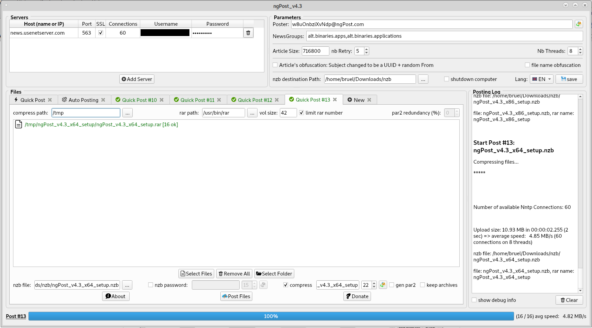

# ngPost-2026

[English](README.md) | [Français](README_FR.md) | [Deutsch](README_DE.md) | [Italiano](README_IT.md) | **Español**

**ngPost-2026** es una versión revisada y rediseñada del famoso cargador de Usenet **ngPost**. 
Es un fork de [mbruel/ngPost](https://github.com/mbruel/ngPost) (v4.16, licencia GPL v3). Todo el mérito del programa original corresponde a su autor, Matthieu Bruel. 

### Qué cambia en este fork
-   **Corrección de seguridad**: posible desbordamiento de memoria en el búfer de codificación yEnc (con ciertos datos la salida podía ser mayor que el búfer)
-   **Contraseñas más seguras**: las contraseñas y nombres de archivo generados usan el generador aleatorio criptográfico del sistema operativo (Qt >= 5.10) en lugar de `std::rand()`
-   **NZB_POST_CMD**: los marcadores pueden contener espacios (una ruta como `C:\Mis carpetas\archivo.nzb` sigue siendo UN SOLO argumento) y el comando se lanza en segundo plano (ngPost ya no lo espera, así que su código de salida ya no se registra)
-   **RAR_EXTRA y PAR2_ARGS**: se analizan respetando las comillas. 7-Zip se detecta por el nombre del programa y no por toda la ruta
-   **ParPar** (un generador de par2 mucho más rápido) se incluye para Windows de 64 bits (v0.4.6, dominio público) y se usa automáticamente cuando `parpar.exe` está en la carpeta de ngPost. Se ha quitado par2cmdline de 64 bits del paquete; el de 32 bits se mantiene para Windows de 32 bits

Este fork todavía no publica binarios: compílalo desde el código fuente (ver más abajo). Los enlaces de descarga de las secciones de instalación son los de ngPost v4.16 original y no incluyen los cambios anteriores. 
 

**Cargador de Usenet por línea de comandos y con una bonita interfaz gráfica** para binarios, desarrollado en **C++11/Qt5** 
está diseñado para ser **lo más rápido posible** y ofrecer TODAS las funciones principales **para publicar datos de forma fácil y segura**. 
puede **comprimir** (con tu programa rar externo) y **generar los par2** antes de publicar! 
tiene una **cola de publicación** para preparar varias publicaciones (sobre todo en la interfaz gráfica con pestañas). 
**prepara la siguiente publicación mientras sube la actual** (compresión + generación de par2) 
puede **automatizar publicaciones** **escaneando carpetas** y publicando cada archivo/carpeta por separado tras comprimirlos (con un posible nombre de archivo y contraseña aleatorios) y generar los par2! 
puede **vigilar carpetas y publicar cada nuevo archivo/carpeta** por separado tras comprimirlos. 
puede **borrar automáticamente archivos/carpetas una vez publicados** (solo con la vigilancia en la interfaz gráfica y con --auto y --monitor a la vez en la línea de comandos) 
puede **ejecutar un COMANDO o un script tras cada publicación** (ver NZB_POST_CMD en el archivo de configuración) 
puede **apagar el ordenador** cuando todas las publicaciones han terminado 
está **traducido al chino, neerlandés, inglés, francés, alemán, portugués y español**. 

[Las versiones del ngPost original están disponibles](https://github.com/mbruel/ngPost/releases/tag/v4.16) para: Linux 64 bits, Windows (32 y 64 bits), MacOS y Raspbian (RPI 4). Pronto para Android y luego iOS...

Estas son las principales funciones y ventajas de ngPost:

-   **ofuscación completa de la cabecera de los artículos**: el asunto es un UUID (como el msg-id) y se usa un remitente aleatorio. **Cuidado**: así no podrás encontrar tu publicación en Usenet (ni en los indexadores) si pierdes el archivo NZB. Pero este método es **totalmente seguro**, **no hace falta ofuscar los archivos ni usar contraseña**.
-   **Cola de publicación**: puedes preparar varias publicaciones mientras publicas otra. Por supuesto puedes cancelar las pendientes ;)
-   **Automatización de publicaciones**: escanea una carpeta y publica cada archivo/carpeta tras comprimirlo. (ver la opción **--auto en la línea de comandos** y la pestaña "Auto Posting" de la interfaz)
-   **compresión con RAR o 7zip** (comando externo) con **ofuscación del nombre** aleatoria y contraseña, y **generación de par2** antes de publicar
-   **historial de publicaciones en un archivo csv**: así tienes la fecha, el **nombre del archivo**, el tamaño, la velocidad de subida y, sobre todo, el **nombre del archivo comprimido y su contraseña** en una sencilla hoja de Excel ;)
-   **ParPar** (mucho más rápido que par2cmdline) se usa automáticamente en Windows de 64 bits si `parpar.exe` está en la carpeta de ngPost (la versión de Windows de 64 bits está en `release/libs`). **par2cmdline** sigue incluido para Windows de 32 bits y, si quieres, puedes usar otra herramienta (como Multipar) con las palabras clave PAR2_CMD y PAR2_ARGS del archivo de configuración
-   admite **varios archivos** y **varias carpetas**
-   admite **varios servidores** (con el archivo de configuración o la interfaz), cada uno con **varias conexiones** (con SSL)
-   reparte esas conexiones en **varios hilos**. Por defecto, el número de núcleos del equipo, pero puedes fijarlo.
-   **prepara los artículos en el hilo principal** (codificación yEnc) para que los hilos de subida estén **siempre listos para escribir**. (cada conexión tiene 2 artículos preparados de antemano)
-   usa **sockets asíncronos** en los hilos de subida
-   **reduce al mínimo el acceso al disco**: los archivos a publicar se abren una sola vez en el hilo principal y se procesan uno tras otro (no hace falta abrir varios a la vez, los artículos se reparten entre todas las conexiones)
-   genera un **remitente aleatorio** (from), pero se puede usar uno fijo
-   **genera el archivo nzb**
-   **gestiona las interrupciones**: si se detiene una publicación, **el nzb se genera con los archivos ya publicados** y **enumera los que no se han publicado**, para que puedas volver a publicar solo esos y unir los nzb a mano. (en línea de comandos la aplicación se cerraría correctamente)
-   **añade metadatos en la cabecera del nzb** (normalmente una contraseña)
-   reintenta publicar los artículos **con otro UUID** en caso de error
-   intenta reconectar si hay un error en un socket (mismo parámetro Retry que para los artículos)
-   ...

### Cómo compilar
#### Dependencias:
- build-essential (compilador C++, libstdc++, make, ...)
- qt5-default (bibliotecas y cabeceras de Qt5)
- qt5-qmake (para generar los archivos moc y crear el Makefile)
- libssl (v1.0.2 o v1.1), pero debería estar ya instalada en tu sistema

#### Compilación:
- ve a la carpeta src
- qmake
- make

¡Fácil! Debería haber generado el ejecutable **ngPost** 
puedes copiarlo a una carpeta de tu PATH para que sea accesible desde cualquier sitio

Como está hecho en C++/Qt, puedes compilarlo y ejecutarlo en cualquier sistema operativo (Linux / Windows / MacOS / Android).  
Hasta ahora solo se han publicado versiones para Linux x64, Windows x64 (de Windows 7 en adelante) y MacOS 
Para compilar en otro sistema, lo más fácil es [instalar Qt](https://www.qt.io/download) y cargar el proyecto en QtCreator 

### Uso en línea de comandos (las descripciones de las opciones son la salida en inglés del programa)
<pre>
Syntax: ngPost (options)* (-i <file or folder> | --auto <folder> | --monitor <folder>)+
	--help             : Help: display syntax
	-v or --version    : app version
	-c or --conf       : use configuration file (if not provided, we try to load $HOME/.ngPost)
	--disp_progress    : display cmd progressbar: NONE (default), BAR or FILES
	-d or --debug      : display extra information
	--fulldebug        : display full debug information
	-l or --lang       : application language
	--check            : check nzb file (if articles are available on Usenet) cf https://github.com/mbruel/nzbCheck
	-q or --quiet      : quiet mode (no output on stdout)

// automated posting (scanning and/or monitoring)
	--auto             : parse directory and post every file/folder separately. You must use --compress, should add --gen_par2, --gen_name and --gen_pass
	--monitor          : monitor directory and post every new file/folder. You must use --compress, should add --gen_par2, --gen_name and --gen_pass
	--rm_posted        : delete file/folder once posted. You must use --auto or --monitor with this option.

// quick posting (several files/folders)
	-i or --input      : input file to upload (single file or directory), you can use it multiple times
	-o or --output     : output file path (nzb)
	-x or --obfuscate  : obfuscate the subjects of the articles (CAREFUL you won't find your post if you lose the nzb file)
	-g or --groups     : newsgroups where to post the files (coma separated without space)
	-m or --meta       : extra meta data in header (typically "password=qwerty42")
	-f or --from       : poster email (random one if not provided)
	-a or --article_size: article size (default one: 716800)
	-z or --msg_id     : msg id signature, after the @ (default one: ngPost)
	-r or --retry      : number of time we retry to an Article that failed (default: 5)
	-t or --thread     : number of Threads (the connections will be distributed amongs them)
	--gen_from         : generate a new random email for each Post (--auto or --monitor)

// for compression and par2 support
	--tmp_dir          : temporary folder where the compressed files and par2 will be stored
	--rar_path         : RAR absolute file path (external application)
	--rar_size         : size in MB of the RAR volumes (0 by default meaning NO split)
	--rar_max          : maximum number of archive volumes
	--par2_pct         : par2 redundancy percentage (0 by default meaning NO par2 generation)
	--par2_path        : par2 absolute file path (in case of self compilation of ngPost)
	--auto_compress    : compress inputs with random name and password and generate par2 (equivalent of --compress --gen_name --gen_pass --gen_par2)
	--compress         : compress inputs using RAR or 7z
	--gen_par2         : generate par2 (to be used with --compress)
	--rar_name         : provide the RAR file name (to be used with --compress)
	--rar_pass         : provide the RAR password (to be used with --compress)
	--gen_name         : generate random RAR name (to be used with --compress)
	--gen_pass         : generate random RAR password (to be used with --compress)
	--length_name      : length of the random RAR name (to be used with --gen_name), default: 17
	--length_pass      : length of the random RAR password (to be used with --gen_pass), default: 13
	--rar_no_root_folder: Remove root (parent) folder when compressing Folders using RAR

// you can provide servers in one string using -S and/or split the parameters for ONE SINGLE server (this will overwrite the configuration file)
	-S or --server     : NNTP server following the format (&lt;user&gt;:&lt;pass&gt;@@@)?&lt;host&gt;:&lt;port&gt;:&lt;nbCons&gt;:(no)?ssl
	-h or --host       : NNTP server hostname (or IP)
	-P or --port       : NNTP server port
	-s or --ssl        : use SSL
	-u or --user       : NNTP server username
	-p or --pass       : NNTP server password
	-n or --connection : number of NNTP connections

Examples:
  - with monitoring: ngPost_v4.16_cmd-x86_64.AppImage --monitor /data/folder1 --monitor /data/folder2 --auto_compress --rm_posted --disp_progress files
  - with auto post: ngPost_v4.16_cmd-x86_64.AppImage --auto /data/folder1 --auto /data/folder2 --compress --gen_par2 --gen_name --gen_pass --rar_size 42 --disp_progress files
  - with compression, filename obfuscation, random password and par2: ngPost_v4.16_cmd-x86_64.AppImage -i /tmp/file1 -i /tmp/folder1 -o /nzb/myPost.nzb --compress --gen_name --gen_pass --gen_par2
  - with config file: ngPost_v4.16_cmd-x86_64.AppImage -c ~/.ngPost -m "password=qwerty42" -f ngPost@nowhere.com -i /tmp/file1 -i /tmp/file2 -i /tmp/folderToPost1 -i /tmp/folderToPost2
  - with all params:  ngPost_v4.16_cmd-x86_64.AppImage -t 1 -m "password=qwerty42" -m "metaKey=someValue" -h news.newshosting.com -P 443 -s -u user -p pass -n 30 -f ngPost@nowhere.com  -g "alt.binaries.test,alt.binaries.test2" -a 64000 -i /tmp/folderToPost -o /tmp/folderToPost.nzb

If you don't provide the output file (nzb file), we will create it in the nzbPath with the name of the first file or folder given in the command line.
so in the second example above, the nzb would be: /tmp/file1.nzb
</pre>

### Archivo de configuración y palabras clave que solo existen allí
El archivo de configuración por defecto en Linux y Mac es: **~/.ngPost** (sin extensión .conf) 
Si quieres, puedes usar otro en la línea de comandos con la opción -c. 
[Aquí tienes el ejemplo a seguir](https://github.com/mbruel/ngPost/blob/master/ngPost.conf). 
 
La mayoría de las palabras clave de la configuración se pueden usar en la línea de comandos, pero algunas solo están en el archivo de configuración:
- **MONITOR_NZB_FOLDERS**: cada publicación de vigilancia va a su propia carpeta creada dentro de nzbPath (Req/Issue #15)
- **inputDir**: carpeta por defecto que se abre para elegir archivos desde la interfaz (puede cambiar si modificas la carpeta Auto en la interfaz y GUARDAS)
- **POST_HISTORY**: archivo csv donde cada publicación correcta añade la fecha, el nombre del archivo, su tamaño, la velocidad de subida, el nombre del archivo comprimido y su contraseña
- **GROUP_POLICY**: define la política al publicar cuando se indican varios grupos (en todos, uno por publicación o uno por archivo)
- **NZB_RM_ACCENTS**: elimina acentos y caracteres especiales de los nombres de los archivos nzb
- **AUTO_CLOSE_TABS**: cierra las pestañas de Quick Post cuando se publican correctamente (para la interfaz)
- **RESUME_WAIT**: tiempo de espera (segundos) antes de intentar reanudar una publicación automáticamente si se pierde la red (mín: 30)
- **NO_RESUME_AUTO**: detiene una publicación cuando se pierde la red
- **PREPARE_PACKING**: cuando hay varias publicaciones en cola, prepara el empaquetado de la siguiente mientras sube la actual

Las siguientes son para publicadores con experiencia:
- **RAR_EXTRA**: para personalizar el comando rar (no hace falta poner 'a', '-idp' ni '-r'). No hace falta para 7-zip, salvo que quieras cambiar el nivel de compresión.
- **PAR2_CMD**: para cambiar el generador de par2 y poder usar [Parpar](https://github.com/animetosho/ParPar) o [Multipar](http://hp.vector.co.jp/authors/VA021385/). (par2cmdline es el generador incluido por defecto; ParPar se usa automáticamente en Windows de 64 bits si `parpar.exe` está en la carpeta de ngPost)
- **PAR2_ARGS**: para personalizar el comando par2, sobre todo si eliges otro programa distinto del par2cmdline por defecto
- **TMP_RAM**: usa una carpeta temporal con límite de tamaño, normalmente una partición tmpfs, para publicar archivos que quepan (si no, se usa TMP_DIR)
- **TMP_RAM_RATIO**: factor aplicado al tamaño de los archivos de origen para compensar la generación de par2

### Versión portátil para Linux de 64 bits (compilada con Qt v5.12.6)
Si no quieres compilar ni instalar las dependencias, también puedes usar la versión portátil, que lo incluye todo. 
- descarga [ngPost_v4.16-x86_64.AppImage](https://github.com/mbruel/ngPost/releases/download/v4.16/ngPost_v4.16-x86_64.AppImage) o [ngPost_v4.16_cmd-x86_64.AppImage](https://github.com/mbruel/ngPost/releases/download/v4.16/ngPost_v4.16_cmd-x86_64.AppImage) para solo línea de comandos (la primera versión sirve para línea de comandos e interfaz)
- chmod 755 ngPost_v4.16-x86_64.AppImage
- lánzala con la misma sintaxis descrita en la sección anterior
- si quieres conservar el archivo de configuración, edita el archivo **~/.ngPost** usando [este modelo](https://raw.githubusercontent.com/mbruel/ngPost/master/ngPost.conf) (sin la extensión .conf)

PD: para sistemas antiguos con GLIBC < 2.24, aquí tienes una versión compilada en Debian8 con GLIBC 2.19 y Qt v5.8.0: [ngPost_v4.16-x86_64_debian8.AppImage](https://github.com/mbruel/ngPost/releases/download/v4.16/ngPost_v4.16-x86_64_debian8.AppImage)

### Versión Raspbian (armhf para Raspberry PI)
- descarga [ngPost_v4.16-armhf.AppImage](https://github.com/mbruel/ngPost/releases/download/v4.16/ngPost_v4.16-armhf.AppImage)
- chmod 755 ngPost_v4.16-armhf.AppImage
- lánzala con la misma sintaxis descrita en la sección anterior
- si quieres conservar el archivo de configuración, edita el archivo **~/.ngPost** usando [este modelo](https://raw.githubusercontent.com/mbruel/ngPost/master/ngPost.conf) (sin la extensión .conf)

**Como rar no está disponible en la RPI, se ha añadido compatibilidad con 7zip.** Usa RAR_PATH para apuntar a 7z y RAR_EXTRA para las opciones de 7zip. Deberías tener algo así:
<pre>
## RAR or 7zip absolute file path (external application)
## /!\ The file MUST EXIST and BE EXECUTABLE /!\
## this is set for Linux environment, Windows users MUST change it
#RAR_PATH = /usr/bin/rar
RAR_PATH = /usr/bin/7z

## RAR EXTRA options (the first 'a' and '-idp' will be added automatically)
## -hp will be added if you use a password with --gen_pass, --rar_pass or using the HMI
## -v42m will be added with --rar_size or using the HMI
## you could change the compression level, lock the archive, add redundancy...
#RAR_EXTRA = -ep1 -m0 -k -rr5p
RAR_EXTRA = -mx0 -mhe=on
</pre>

### Instalador para Windows
- usa simplemente el paquete [ngPost_v4.16_x64_setup.exe](https://github.com/mbruel/ngPost/releases/download/v4.16/ngPost_v4.16_x64_setup.exe) o [ngPost_v4.16_x86_setup.exe](https://github.com/mbruel/ngPost/releases/download/v4.16/ngPost_v4.16_x86_setup.exe) para la versión de 32 bits
- edita **ngPost.conf** (en la carpeta de instalación) para añadir los datos de tus servidores (puedes poner varios).
- lanza **ngPost.exe** (versión con interfaz gráfica)
- o úsalo en la línea de comandos: **ngPost.exe** -i "tu archivo o carpeta"

si lo prefieres, puedes dar todos los parámetros del servidor en la línea de comandos (ver la sección anterior) 
Por defecto:
- ngPost cargará el archivo de configuración 'ngPost.conf' que está en la carpeta
- también escribirá el archivo nzb en esta carpeta. (su nombre será el del último archivo indicado en la línea de comandos)

**Problema conocido sin compatibilidad SSL:** puede que necesites instalar los [redistribuibles de msvc2015](https://www.microsoft.com/en-us/download/details.aspx?id=48145), ya que libssl depende de sus API 

### Versión para MacOS compilada en High Sierra (v10.13)
- descarga [ngPost_v4.16.1.dmg](https://github.com/mbruel/ngPost/releases/download/v4.16/ngPost_v4.16.1.dmg)
- lánzala con la misma sintaxis descrita en la sección anterior
- si quieres conservar el archivo de configuración, edita el archivo **~/.ngPost** usando [este modelo](https://raw.githubusercontent.com/mbruel/ngPost/master/ngPost.conf) (sin la extensión .conf)

### Alternativas

Una lista de cargadores de Usenet del GitHub de Nyuu [se encuentra aquí](https://github.com/animetosho/Nyuu/wiki/Usenet-Uploaders).

### Licencia
**ngPost** se publica bajo licencia **GPL v3**
<pre>
//========================================================================
//
// Copyright (C) 2020 Matthieu Bruel <Matthieu.Bruel@gmail.com>
// This file is a part of ngPost : https://github.com/mbruel/ngPost
//
// This program is free software: you can redistribute it and/or modify
// it under the terms of the GNU General Public License as published by
// the Free Software Foundation, version 3..
//
// This program is distributed in the hope that it will be useful,
// but WITHOUT ANY WARRANTY; without even the implied warranty of
// MERCHANTABILITY or FITNESS FOR A PARTICULAR PURPOSE.  See the
// GNU General Public License for more details.
//
// You should have received a copy of the GNU General Public License
// along with this program. If not, see <http://www.gnu.org/licenses/>
//
//========================================================================
</pre>

### Preguntas / Problemas / Peticiones
- para preguntas sobre este fork, puedes contactar con su mantenedor en GitHub: [thenormal](https://github.com/thenormal)
- para el programa original, consulta el [proyecto original](https://github.com/mbruel/ngPost) y a su autor Matthieu Bruel

### Idiomas admitidos
Por ahora ngPost está traducido al chino, neerlandés, inglés, francés, alemán, portugués y español. Para este fork está prevista una traducción al italiano. 
Si quieres traducir ngPost a tu idioma, es fácil (hay una buena interfaz para ello: QtLinguist). Los archivos de traducción están en la carpeta **src/lang**.

### Agradecimientos
- Matthieu Bruel (mbruel) por haber creado ngPost y publicarlo bajo GPL v3
- Uukrull por sus intensas pruebas y comentarios y por construir todos los paquetes de MacOS.
- awsms por sus pruebas en un servidor de verdad con conexión de 10 Gb/s que ayudaron a mejorar la velocidad de subida de ngPost y la compatibilidad con multihilo
- animetosho por haber desarrollado ParPar, el generador de par2 más rápido que existe!
- demanuel por el desarrollo de NewsUP, que fue mi primer cargador
- noobcoder1983, tensai y luego yuppie por la traducción al alemán
- tiriclote por la traducción al español
- hunesco por la traducción al portugués
- Peng por la traducción al chino
- todos los usuarios de ngPost ;)

### Apoyar al autor original
ngPost fue creado por Matthieu Bruel. Si usas la aplicación y quieres contribuir al esfuerzo, hazlo en el [proyecto original](https://github.com/mbruel/ngPost).
