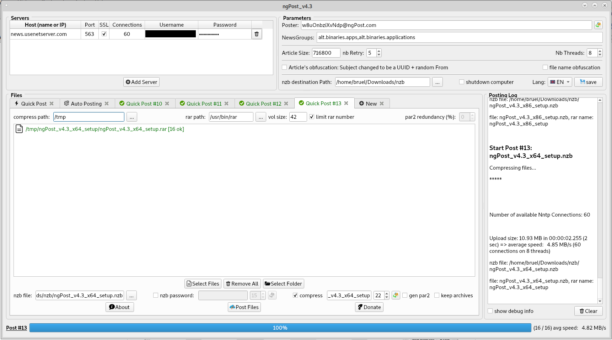

# ngPost-2026

[English](README.md) | [Français](README_FR.md) | [Deutsch](README_DE.md) | **Italiano** | [Español](README_ES.md)

**ngPost-2026** è una versione rivista e ridisegnata del famoso uploader Usenet **ngPost**. 
È un fork di [mbruel/ngPost](https://github.com/mbruel/ngPost) (v4.16, licenza GPL v3). Il merito del programma originale va al suo autore, Matthieu Bruel. 

### Cosa cambia in questo fork
-   **Correzione di sicurezza**: possibile overflow dell'heap nel buffer di codifica yEnc (con certi dati l'output poteva essere più grande del buffer)
-   **Password più sicure**: le password e i nomi degli archivi generati usano il generatore casuale crittografico del sistema operativo (Qt >= 5.10) invece di `std::rand()`
-   **NZB_POST_CMD**: i segnaposto possono contenere spazi (un percorso come `C:\Le mie cartelle\file.nzb` resta UN SOLO argomento) e il comando viene avviato in background (ngPost non lo aspetta più, quindi il suo codice di uscita non viene più registrato)
-   **RAR_EXTRA e PAR2_ARGS**: analizzati rispettando le virgolette. 7-Zip viene riconosciuto dal nome del programma e non dall'intero percorso
-   **ParPar** (un generatore di par2 molto più veloce) è incluso per Windows a 64 bit (v0.4.6, pubblico dominio) e usato automaticamente quando `parpar.exe` si trova nella cartella di ngPost. par2cmdline a 64 bit è stato tolto dal pacchetto, quello a 32 bit resta per Windows a 32 bit

Questo fork non pubblica ancora file binari: compilalo dai sorgenti (vedi sotto). I link di download delle sezioni di installazione sono quelli di ngPost v4.16 originale e non contengono le modifiche qui sopra. 
 

**Poster Usenet da riga di comando e con una bella interfaccia grafica** per file binari, sviluppato in **C++11/Qt5** 
è progettato per essere **il più veloce possibile** e offrire TUTTE le funzioni principali **per postare dati in modo semplice e sicuro**. 
può **comprimere** (con il tuo programma rar esterno) e **generare i par2** prima di postare! 
ha una **coda di invio** per preparare più post (soprattutto nell'interfaccia grafica con le schede). 
**prepara il post successivo mentre carica quello attuale** (compressione + generazione dei par2) 
può **automatizzare i post** **scansionando cartelle** e postando ogni file/cartella singolarmente dopo averli compressi (con un eventuale nome d'archivio e password casuali) e aver generato i par2! 
può **monitorare cartelle e postare ogni nuovo file/cartella** singolarmente dopo averli compressi. 
può **eliminare automaticamente file/cartelle dopo il post** (solo con il monitoraggio nell'interfaccia grafica e con --auto e --monitor insieme da riga di comando) 
può **eseguire un COMANDO o uno script dopo ogni post** (vedi NZB_POST_CMD nel file di configurazione) 
può **spegnere il computer** quando tutti i post sono finiti 
è **tradotto in cinese, olandese, inglese, francese, tedesco, portoghese e spagnolo**. 

[Le release di ngPost originale sono disponibili](https://github.com/mbruel/ngPost/releases/tag/v4.16) per: Linux 64 bit, Windows (32 e 64 bit), MacOS e Raspbian (RPI 4). Presto anche per Android e poi iOS...

Ecco le principali funzioni e vantaggi di ngPost:

-   **offuscamento completo dell'header degli articoli**: l'oggetto è un UUID (come il msg-id) e viene usato un mittente casuale. **Attenzione**: così non potrai ritrovare il tuo post su Usenet (o negli indicizzatori) se perdi il file NZB. Ma questo metodo è **completamente sicuro**, **non serve offuscare i file né usare una password**.
-   **Coda di invio**: puoi preparare più post mentre ne stai postando uno. Puoi ovviamente annullare quelli in attesa ;)
-   **Automazione dei post**: scansiona una cartella e posta ogni file/cartella dopo la compressione. (vedi l'opzione **--auto da riga di comando** e la scheda "Auto Posting" nell'interfaccia)
-   **compressione con RAR o 7zip** (comando esterno) con **offuscamento del nome** casuale e password, e **generazione dei par2** prima di postare
-   **cronologia dei post in un file csv**: così hai data, **nome del file**, dimensione, velocità di upload e, soprattutto, **nome dell'archivio e password** in un semplice foglio Excel ;)
-   **ParPar** (molto più veloce di par2cmdline) viene usato automaticamente su Windows a 64 bit se `parpar.exe` si trova nella cartella di ngPost (la versione Windows a 64 bit è in `release/libs`). **par2cmdline** è ancora incluso per Windows a 32 bit e, se vuoi, puoi usare un altro programma (come Multipar) con le parole chiave PAR2_CMD e PAR2_ARGS nel file di configurazione
-   supporta **più file** e **più cartelle**
-   supporta **più server** (da file di configurazione o dall'interfaccia), ognuno con **più connessioni** (con SSL)
-   distribuisce queste connessioni su **più thread**. Di default il numero di core del computer, ma puoi impostarlo.
-   **prepara gli articoli nel thread principale** (codifica yEnc) così i thread di upload sono **sempre pronti a scrivere**. (ogni connessione ha 2 articoli pronti in anticipo)
-   usa **socket asincroni** nei thread di upload
-   **riduce al minimo gli accessi al disco**: i file da postare vengono aperti una sola volta nel thread principale ed elaborati uno alla volta (non serve aprire più file insieme, gli articoli vengono distribuiti su tutte le connessioni)
-   genera un **mittente casuale** (from), ma si può usarne uno fisso
-   **genera il file nzb**
-   **gestisce le interruzioni**: se un post viene fermato, **l'nzb viene generato con i file già postati** e **elenca i file non postati**, così puoi ripostare solo quelli e poi unire a mano i file nzb. (da riga di comando l'applicazione si chiuderebbe correttamente)
-   **aggiunge meta-dati nell'header dell'nzb** (tipicamente una password)
-   riprova a postare gli articoli **con un UUID diverso** in caso di errore
-   prova a riconnettersi se c'è un errore su un socket (stesso parametro Retry degli articoli)
-   ...

### Come compilare
#### Dipendenze:
- build-essential (compilatore C++, libstdc++, make, ...)
- qt5-default (librerie e header di Qt5)
- qt5-qmake (per generare i file moc e creare il Makefile)
- libssl (v1.0.2 o v1.1), ma dovrebbe essere già installata sul tuo sistema

#### Compilazione:
- vai nella cartella src
- qmake
- make

Facile! Dovrebbe aver generato l'eseguibile **ngPost** 
puoi copiarlo in una cartella del tuo PATH così sarà accessibile da ovunque

Essendo fatto in C++/Qt, puoi compilarlo ed eseguirlo su qualsiasi sistema operativo (Linux / Windows / MacOS / Android).  
Finora le release sono state fatte solo per Linux x64, Windows x64 (da Windows 7 in su) e MacOS 
Per compilare su un altro sistema, la cosa più semplice è [installare Qt](https://www.qt.io/download) e caricare il progetto in QtCreator 

### Uso da riga di comando (le descrizioni delle opzioni sono l'output inglese del programma)
<pre>
Syntax: ngPost (options)* (-i <file or folder> | --auto <folder> | --monitor <folder>)+
	--help             : Help: display syntax
	-v or --version    : app version
	-c or --conf       : use configuration file (if not provided, we try to load $HOME/.ngPost)
	--disp_progress    : display cmd progressbar: NONE (default), BAR or FILES
	-d or --debug      : display extra information
	--fulldebug        : display full debug information
	-l or --lang       : application language
	--check            : check nzb file (if articles are available on Usenet) cf https://github.com/mbruel/nzbCheck
	-q or --quiet      : quiet mode (no output on stdout)

// automated posting (scanning and/or monitoring)
	--auto             : parse directory and post every file/folder separately. You must use --compress, should add --gen_par2, --gen_name and --gen_pass
	--monitor          : monitor directory and post every new file/folder. You must use --compress, should add --gen_par2, --gen_name and --gen_pass
	--rm_posted        : delete file/folder once posted. You must use --auto or --monitor with this option.

// quick posting (several files/folders)
	-i or --input      : input file to upload (single file or directory), you can use it multiple times
	-o or --output     : output file path (nzb)
	-x or --obfuscate  : obfuscate the subjects of the articles (CAREFUL you won't find your post if you lose the nzb file)
	-g or --groups     : newsgroups where to post the files (coma separated without space)
	-m or --meta       : extra meta data in header (typically "password=qwerty42")
	-f or --from       : poster email (random one if not provided)
	-a or --article_size: article size (default one: 716800)
	-z or --msg_id     : msg id signature, after the @ (default one: ngPost)
	-r or --retry      : number of time we retry to an Article that failed (default: 5)
	-t or --thread     : number of Threads (the connections will be distributed amongs them)
	--gen_from         : generate a new random email for each Post (--auto or --monitor)

// for compression and par2 support
	--tmp_dir          : temporary folder where the compressed files and par2 will be stored
	--rar_path         : RAR absolute file path (external application)
	--rar_size         : size in MB of the RAR volumes (0 by default meaning NO split)
	--rar_max          : maximum number of archive volumes
	--par2_pct         : par2 redundancy percentage (0 by default meaning NO par2 generation)
	--par2_path        : par2 absolute file path (in case of self compilation of ngPost)
	--auto_compress    : compress inputs with random name and password and generate par2 (equivalent of --compress --gen_name --gen_pass --gen_par2)
	--compress         : compress inputs using RAR or 7z
	--gen_par2         : generate par2 (to be used with --compress)
	--rar_name         : provide the RAR file name (to be used with --compress)
	--rar_pass         : provide the RAR password (to be used with --compress)
	--gen_name         : generate random RAR name (to be used with --compress)
	--gen_pass         : generate random RAR password (to be used with --compress)
	--length_name      : length of the random RAR name (to be used with --gen_name), default: 17
	--length_pass      : length of the random RAR password (to be used with --gen_pass), default: 13
	--rar_no_root_folder: Remove root (parent) folder when compressing Folders using RAR

// you can provide servers in one string using -S and/or split the parameters for ONE SINGLE server (this will overwrite the configuration file)
	-S or --server     : NNTP server following the format (&lt;user&gt;:&lt;pass&gt;@@@)?&lt;host&gt;:&lt;port&gt;:&lt;nbCons&gt;:(no)?ssl
	-h or --host       : NNTP server hostname (or IP)
	-P or --port       : NNTP server port
	-s or --ssl        : use SSL
	-u or --user       : NNTP server username
	-p or --pass       : NNTP server password
	-n or --connection : number of NNTP connections

Examples:
  - with monitoring: ngPost_v4.16_cmd-x86_64.AppImage --monitor /data/folder1 --monitor /data/folder2 --auto_compress --rm_posted --disp_progress files
  - with auto post: ngPost_v4.16_cmd-x86_64.AppImage --auto /data/folder1 --auto /data/folder2 --compress --gen_par2 --gen_name --gen_pass --rar_size 42 --disp_progress files
  - with compression, filename obfuscation, random password and par2: ngPost_v4.16_cmd-x86_64.AppImage -i /tmp/file1 -i /tmp/folder1 -o /nzb/myPost.nzb --compress --gen_name --gen_pass --gen_par2
  - with config file: ngPost_v4.16_cmd-x86_64.AppImage -c ~/.ngPost -m "password=qwerty42" -f ngPost@nowhere.com -i /tmp/file1 -i /tmp/file2 -i /tmp/folderToPost1 -i /tmp/folderToPost2
  - with all params:  ngPost_v4.16_cmd-x86_64.AppImage -t 1 -m "password=qwerty42" -m "metaKey=someValue" -h news.newshosting.com -P 443 -s -u user -p pass -n 30 -f ngPost@nowhere.com  -g "alt.binaries.test,alt.binaries.test2" -a 64000 -i /tmp/folderToPost -o /tmp/folderToPost.nzb

If you don't provide the output file (nzb file), we will create it in the nzbPath with the name of the first file or folder given in the command line.
so in the second example above, the nzb would be: /tmp/file1.nzb
</pre>

### File di configurazione e parole chiave presenti solo lì
Il file di configurazione predefinito su Linux e Mac è: **~/.ngPost** (senza estensione .conf) 
Se vuoi, puoi usarne un altro da riga di comando con l'opzione -c. 
[Qui l'esempio da seguire](https://github.com/mbruel/ngPost/blob/master/ngPost.conf). 
 
La maggior parte delle parole chiave della configurazione si può usare anche da riga di comando, ma alcune sono solo nel file di configurazione:
- **MONITOR_NZB_FOLDERS**: ogni post di monitoraggio va in una sua cartella creata dentro nzbPath (Req/Issue #15)
- **inputDir**: cartella predefinita da aprire per scegliere i file dall'interfaccia (può cambiare se modifichi la cartella Auto nell'interfaccia e SALVI)
- **POST_HISTORY**: file csv in cui ogni post riuscito aggiunge data, nome del file, dimensione, velocità di upload, nome dell'archivio e password
- **GROUP_POLICY**: definisce come postare quando sono indicati più gruppi (su tutti, uno per post o uno per file)
- **NZB_RM_ACCENTS**: rimuove accenti e caratteri speciali dai nomi dei file nzb
- **AUTO_CLOSE_TABS**: chiude le schede Quick Post quando il post riesce (per l'interfaccia)
- **RESUME_WAIT**: tempo di attesa (secondi) prima di riprovare a riprendere un post automaticamente se cade la rete (min: 30)
- **NO_RESUME_AUTO**: ferma un post quando si perde la rete
- **PREPARE_PACKING**: con più post in coda, prepara il packing del successivo mentre carica quello attuale

Le seguenti sono per chi posta già con esperienza:
- **RAR_EXTRA**: per personalizzare il comando rar (non serve indicare 'a', '-idp' o '-r'). Non serve per 7-zip, tranne se vuoi cambiare il livello di compressione.
- **PAR2_CMD**: per cambiare il generatore di par2 e poter usare [Parpar](https://github.com/animetosho/ParPar) o [Multipar](http://hp.vector.co.jp/authors/VA021385/). (par2cmdline è il generatore incluso di default, ParPar viene usato automaticamente su Windows a 64 bit se `parpar.exe` è nella cartella di ngPost)
- **PAR2_ARGS**: per personalizzare il comando par2, soprattutto se scegli un programma diverso dal par2cmdline predefinito
- **TMP_RAM**: usa una cartella temporanea con limite di dimensione, tipicamente una partizione tmpfs, per i post che ci stanno (altrimenti si usa TMP_DIR)
- **TMP_RAM_RATIO**: rapporto applicato alla dimensione dei file sorgente per compensare la generazione dei par2

### Versione portatile Linux a 64 bit (compilata con Qt v5.12.6)
Se non vuoi compilare e installare le dipendenze, puoi usare anche la versione portatile che include tutto. 
- scarica [ngPost_v4.16-x86_64.AppImage](https://github.com/mbruel/ngPost/releases/download/v4.16/ngPost_v4.16-x86_64.AppImage) oppure [ngPost_v4.16_cmd-x86_64.AppImage](https://github.com/mbruel/ngPost/releases/download/v4.16/ngPost_v4.16_cmd-x86_64.AppImage) per la sola riga di comando (la prima versione fa sia riga di comando sia interfaccia)
- chmod 755 ngPost_v4.16-x86_64.AppImage
- avviala con la stessa sintassi descritta nella sezione sopra
- se vuoi mantenere il file di configurazione, modifica il file **~/.ngPost** usando [questo modello](https://raw.githubusercontent.com/mbruel/ngPost/master/ngPost.conf) (senza l'estensione .conf)

PS: per i sistemi più vecchi con GLIBC < 2.24, ecco una versione compilata su Debian8 con GLIBC 2.19 e Qt v5.8.0: [ngPost_v4.16-x86_64_debian8.AppImage](https://github.com/mbruel/ngPost/releases/download/v4.16/ngPost_v4.16-x86_64_debian8.AppImage)

### Versione Raspbian (armhf per Raspberry PI)
- scarica [ngPost_v4.16-armhf.AppImage](https://github.com/mbruel/ngPost/releases/download/v4.16/ngPost_v4.16-armhf.AppImage)
- chmod 755 ngPost_v4.16-armhf.AppImage
- avviala con la stessa sintassi descritta nella sezione sopra
- se vuoi mantenere il file di configurazione, modifica il file **~/.ngPost** usando [questo modello](https://raw.githubusercontent.com/mbruel/ngPost/master/ngPost.conf) (senza l'estensione .conf)

**Poiché rar non è disponibile su RPI, è stato aggiunto il supporto a 7zip.** Usa RAR_PATH per puntare a 7z e RAR_EXTRA per le opzioni di 7zip. Dovresti avere qualcosa di simile:
<pre>
## RAR or 7zip absolute file path (external application)
## /!\ The file MUST EXIST and BE EXECUTABLE /!\
## this is set for Linux environment, Windows users MUST change it
#RAR_PATH = /usr/bin/rar
RAR_PATH = /usr/bin/7z

## RAR EXTRA options (the first 'a' and '-idp' will be added automatically)
## -hp will be added if you use a password with --gen_pass, --rar_pass or using the HMI
## -v42m will be added with --rar_size or using the HMI
## you could change the compression level, lock the archive, add redundancy...
#RAR_EXTRA = -ep1 -m0 -k -rr5p
RAR_EXTRA = -mx0 -mhe=on
</pre>

### Installer per Windows
- usa semplicemente il pacchetto [ngPost_v4.16_x64_setup.exe](https://github.com/mbruel/ngPost/releases/download/v4.16/ngPost_v4.16_x64_setup.exe) oppure [ngPost_v4.16_x86_setup.exe](https://github.com/mbruel/ngPost/releases/download/v4.16/ngPost_v4.16_x86_setup.exe) per la versione a 32 bit
- modifica **ngPost.conf** (nella cartella di installazione) per aggiungere le impostazioni dei tuoi server (puoi metterne più di uno).
- avvia **ngPost.exe** (versione con interfaccia grafica)
- oppure usalo da riga di comando: **ngPost.exe** -i "il tuo file o la tua cartella"

se preferisci, puoi dare tutti i parametri del server da riga di comando (vedi la sezione sopra) 
Di default:
- ngPost carica il file di configurazione 'ngPost.conf' che si trova nella cartella
- scrive il file nzb anche in questa cartella. (il nome è quello dell'ultimo file indicato nella riga di comando)

**Problema noto senza supporto SSL:** potresti dover installare i [redistribuibili msvc2015](https://www.microsoft.com/en-us/download/details.aspx?id=48145) perché libssl dipende dalle loro API 

### Versione MacOS compilata su High Sierra (v10.13)
- scarica [ngPost_v4.16.1.dmg](https://github.com/mbruel/ngPost/releases/download/v4.16/ngPost_v4.16.1.dmg)
- avviala con la stessa sintassi descritta nella sezione sopra
- se vuoi mantenere il file di configurazione, modifica il file **~/.ngPost** usando [questo modello](https://raw.githubusercontent.com/mbruel/ngPost/master/ngPost.conf) (senza l'estensione .conf)

### Alternative

Un elenco di poster Usenet dal GitHub di Nyuu [si trova qui](https://github.com/animetosho/Nyuu/wiki/Usenet-Uploaders).

### Licenza
**ngPost** è pubblicato con licenza **GPL v3**
<pre>
//========================================================================
//
// Copyright (C) 2020 Matthieu Bruel <Matthieu.Bruel@gmail.com>
// This file is a part of ngPost : https://github.com/mbruel/ngPost
//
// This program is free software: you can redistribute it and/or modify
// it under the terms of the GNU General Public License as published by
// the Free Software Foundation, version 3..
//
// This program is distributed in the hope that it will be useful,
// but WITHOUT ANY WARRANTY; without even the implied warranty of
// MERCHANTABILITY or FITNESS FOR A PARTICULAR PURPOSE.  See the
// GNU General Public License for more details.
//
// You should have received a copy of the GNU General Public License
// along with this program. If not, see <http://www.gnu.org/licenses/>
//
//========================================================================
</pre>

### Domande / Problemi / Richieste
- per domande su questo fork puoi contattare il suo manutentore su GitHub: [thenormal](https://github.com/thenormal)
- per il programma originale fai riferimento al [progetto originale](https://github.com/mbruel/ngPost) e al suo autore Matthieu Bruel

### Lingue supportate
Per ora ngPost è tradotto in cinese, olandese, inglese, francese, tedesco, portoghese e spagnolo. Per questo fork è prevista una traduzione italiana. 
Se vuoi tradurre ngPost nella tua lingua è facile (c'è una comoda interfaccia: QtLinguist). I file di traduzione sono nella cartella **src/lang**.

### Ringraziamenti
- Matthieu Bruel (mbruel) per aver creato ngPost e averlo pubblicato con licenza GPL v3
- Uukrull per i suoi test intensivi e i suggerimenti e per aver costruito tutti i pacchetti MacOS.
- awsms per i suoi test su un vero server con connessione da 10 Gb/s che hanno aiutato a migliorare la velocità di upload di ngPost e il supporto al multi-threading
- animetosho per aver sviluppato ParPar, il generatore di par2 più veloce di sempre!
- demanuel per lo sviluppo di NewsUP, che è stato il mio primo poster
- noobcoder1983, tensai e poi yuppie per la traduzione tedesca
- tiriclote per la traduzione spagnola
- hunesco per la traduzione portoghese
- Peng per la traduzione cinese
- tutti gli utenti di ngPost ;)

### Sostenere l'autore originale
ngPost è stato creato da Matthieu Bruel. Se usi l'app e vuoi contribuire allo sforzo, fallo sul [progetto originale](https://github.com/mbruel/ngPost).
